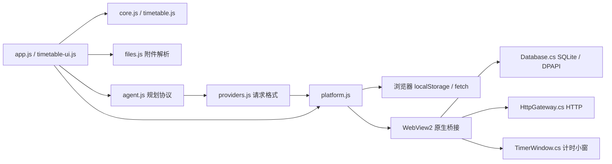

# 模块与数据流

## 两种运行方式

浏览器和 Windows 版共用 `v4/index.html` 与同一套 JavaScript。`platform.js` 检测宿主能力后选择浏览器实现或 WebView2 原生桥接；没有远程业务后端，也不需要本机 HTTP 服务来启动桌面版。

## 前端文件

| 文件 | 职责 |
| --- | --- |
| `v4/js/core.js` | 状态结构与兼容迁移、任务提议校验、计时、历史与规划上下文 |
| `v4/js/app.js` | 主界面渲染、事件、设置、任务/习惯/目标与回看操作 |
| `v4/js/agent.js` | 系统提示、结构化模型回复、工具循环与最终提议 |
| `v4/js/providers.js` | 服务商预设、模型列表、文本/图像请求格式 |
| `v4/js/platform.js` | 数据、密钥、HTTP 和原生计时命令的统一接口 |
| `v4/js/files.js` | Office ZIP/XML 解析、PDF.js 文字提取与页面渲染、图片预处理 |
| `v4/js/timetable.js` | 学期校验、文本/表格规则、单双周展开、去重、冲突、导入/撤销 |
| `v4/js/timetable-ui.js` | 学期设置、文件导入、模型调用、预览编辑和周视图 |

`core.js` 和 `timetable.js` 可通过 CommonJS 在 Node 中测试；界面文件直接通过浏览器脚本加载。修改加载顺序时，应保持课表规则先于依赖它的核心和界面模块。

## 桌面文件

| 文件 | 职责 |
| --- | --- |
| `Program.cs` | 版本元数据、独立数据目录、单实例锁、自检入口 |
| `MainWindow.cs` | WebView2 初始化、本地虚拟域名映射、导航约束与消息分发 |
| `Database.cs` | 调用 Windows `winsqlite3.dll`，保存 `tplan.v4` 状态与 DPAPI 密文 |
| `HttpGateway.cs` | 模型 HTTP 请求、取消、超时相关传输；只允许 HTTPS 或本机 HTTP |
| `TimerWindow.cs` | 原生置顶小窗及计时控制命令 |
| `qa.js` / `qa-timetable.js` | 编译进程序的界面自检脚本，只有自检模式会执行 |

## 数据边界

- 状态格式 version 2 包含课表配置和课程规则；校验后再写入。
- 课程规则按学期起点、周次、星期和节次展开为具体日期与钟点；显式钟点优先于节次模板。
- API 密钥独立于状态 JSON。桌面通过 DPAPI 加密，浏览器通过自身 localStorage 保存。
- 模型提议与课表识别结果均经过预览/确认才改变安排。
- 模型可读取用户主动提供的附件和允许的上下文；本版不开放任意磁盘路径或文件夹遍历。
- 浏览器、桌面和不同网页来源之间不自动共享或同步状态。

## 源码范围

v4 网页原型来源于 [T-project-11-14](https://github.com/fanzite629/T-project-11-14)，整理时上游提交为 `7ecb9f1`，并包含该工作区随后实现的桌面封装和课表改动。此仓库独立保存当前源码快照，不携带旧仓库的 Git 历史、个人数据库或打包结果。

`desktop/app.manifest`、`desktop/TPlan.exe.config`、`desktop/vendor/` 来源记录和 `v3-desktop/` 图标仍按原构建路径保留，均为 v4 的直接构建输入。
